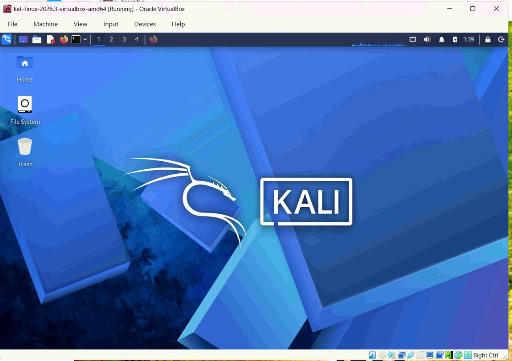
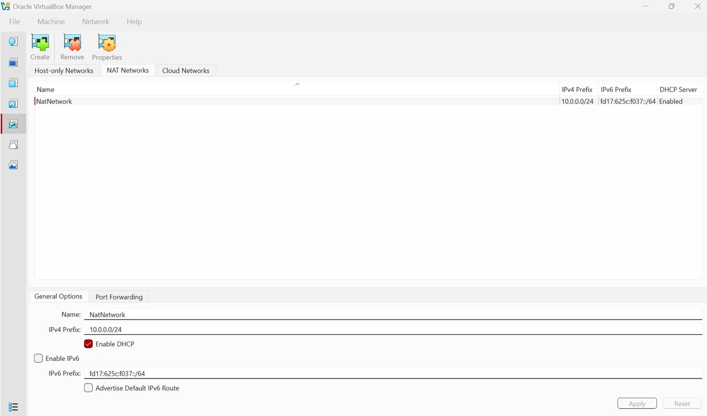
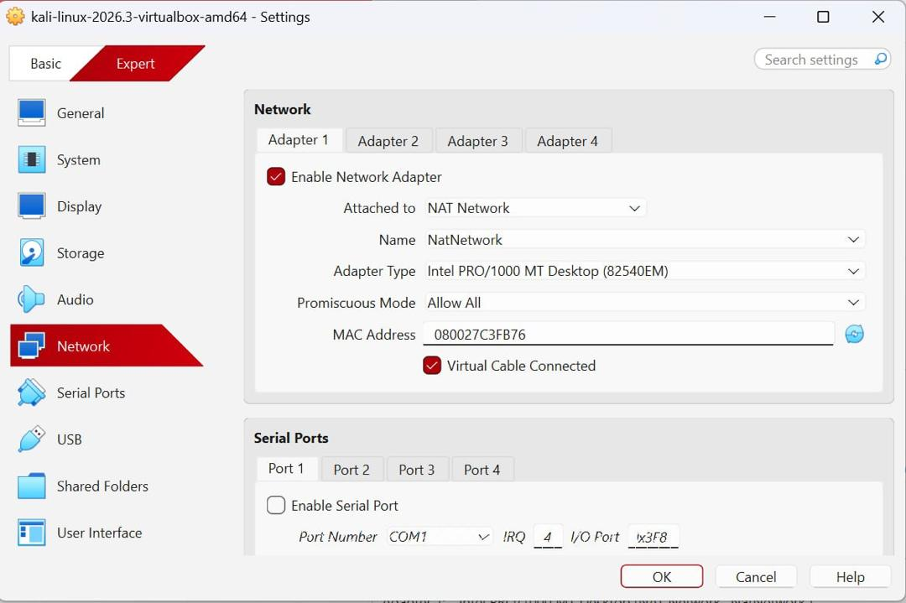
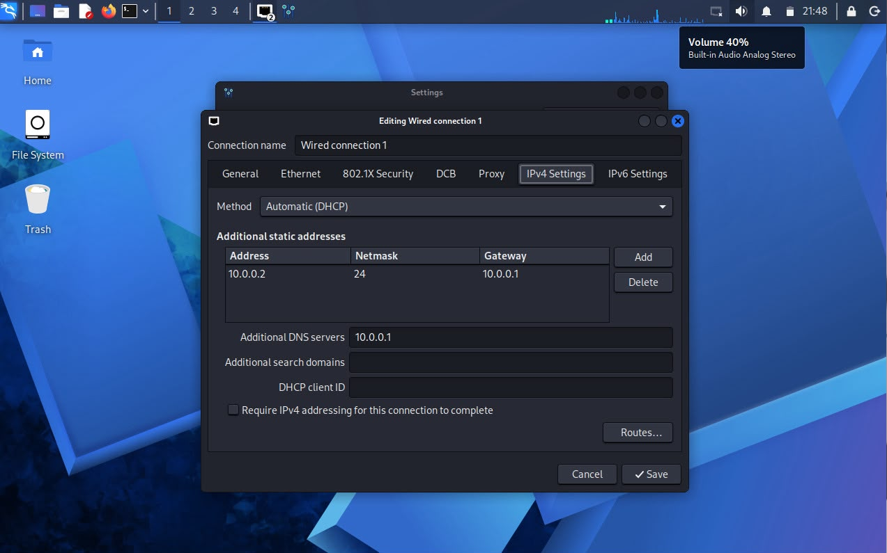
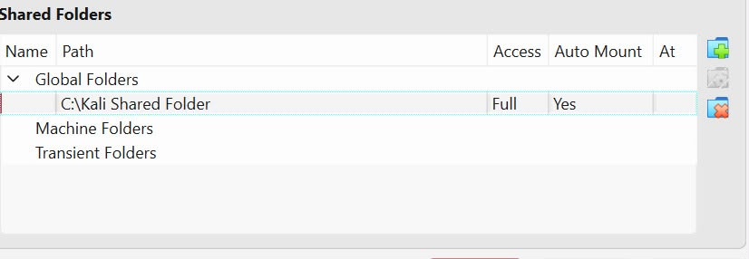
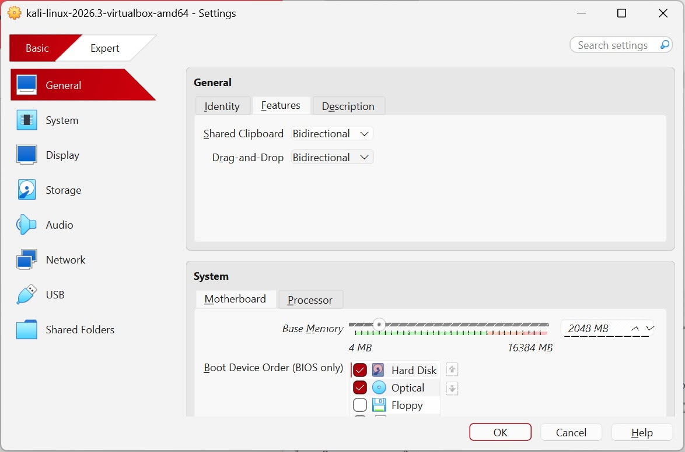
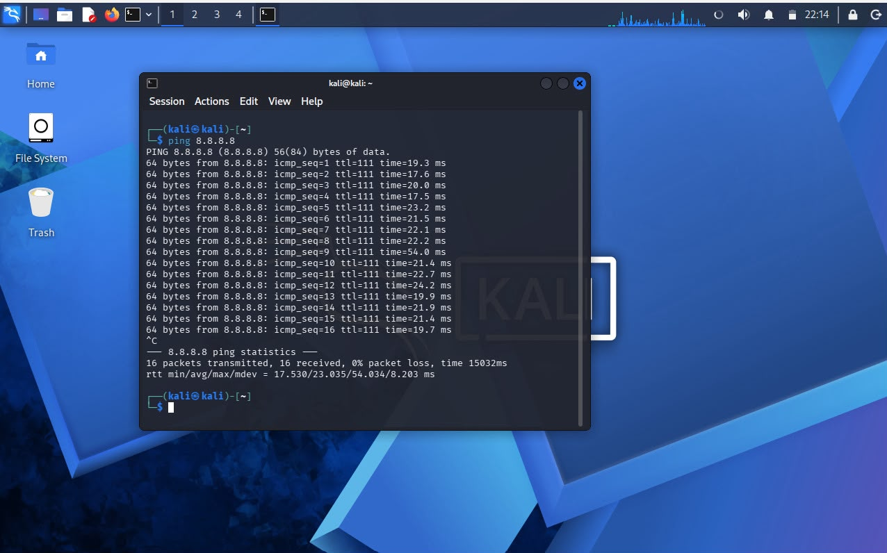
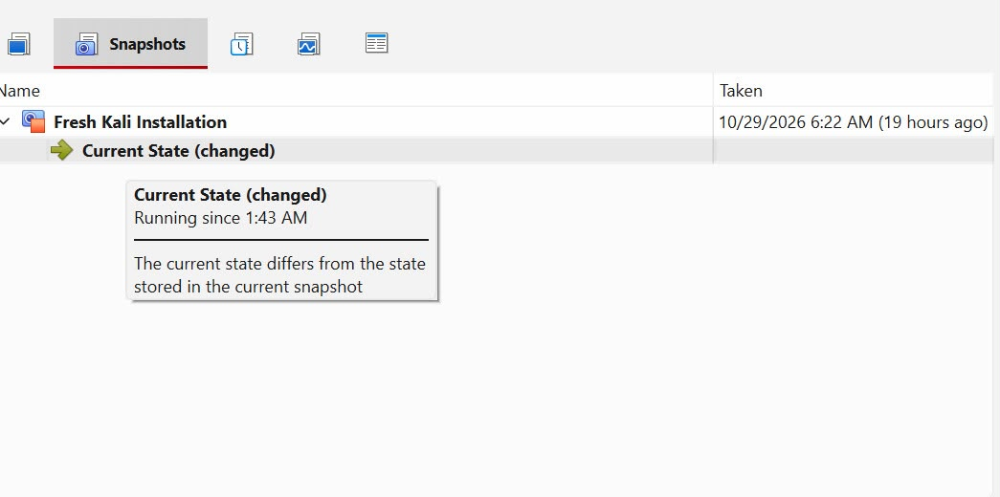

# WK1-PM1 Cybersecurity Lab Setup

## Project Overview

This repository documents the completion of Week 1, Project Module 1 (WK1-PM1) Cybersecurity Lab Setup.

The objective of this project was to create a virtual cybersecurity testing environment using Oracle VirtualBox and Kali Linux. This lab environment will be used for future cybersecurity, networking, and ethical hacking exercises.

---

## Project Objectives

- Install Oracle VirtualBox.
- Download and import Kali Linux.
- Configure a NAT Network using the 10.0.0.0/24 subnet.
- Assign Kali Linux the IP address 10.0.0.2/24.
- Enable shared clipboard and drag-and-drop functionality.
- Configure a shared folder between the host operating system and Kali Linux.
- Verify internet access from Kali Linux.
- Create a virtual machine snapshot.

---

## Tools Used

| Tool | Purpose |
|--------|---------|
| Oracle VirtualBox | Virtualization platform |
| Kali Linux | Cybersecurity testing operating system |
| 7-Zip | File extraction utility |

---

## Network Configuration

| Setting | Configuration |
|----------|--------------|
| Network Type | NAT Network |
| Network Address | 10.0.0.0/24 |
| Gateway | 10.0.0.1 |
| Kali Linux IP | 10.0.0.2/24 |
| Internet Access | Verified |

---

## Project Implementation

### Phase 1: Lab Setup

1. Installed 7-Zip.
2. Installed Oracle VirtualBox.
3. Created a NAT Network using the 10.0.0.0/24 subnet.
4. Downloaded and imported Kali Linux.
5. Configured network settings for Kali Linux.
6. Enabled clipboard sharing and drag-and-drop.
7. Configured shared folders.
8. Verified internet connectivity.
9. Created a virtual machine snapshot.

---

## Screenshots

The screenshots folder contains evidence of:
- Kali Installation

- NAT Network configuration

- Kali Linux virtual machine settings
  
- Kali Linux Static IP Configuration

- Shared Folder Configuartion
  
- Clipboard and Drag & Drop Settings
 
- Internet Connectivity Verfication
 
- Virtual Machine Snapshot

 ---
## 🐞 Challenges Encountered and Solutions


### Challenge 1: Internet Connectivity After Static IP Configuration


**Problem:** After configuring a static IP address on Kali Linux, internet connectivity may fail because of network configuration issues.


**Solution:** The network connection settings were checked to identify the cause. One possible workaround for a specific NetworkManager configuration is:


```bash
sudo nmcli connection modify "Wired connection 1" ipv4.dad-timeout 0
```


The network connection can then be restarted and connectivity tested again.


**Verification:** Test the connection using:


```bash
ping -c 4 8.8.8.8
getent hosts google.com
```


**Note:** The connection name may differ between systems. Identify the correct connection before running the command. The `ipv4.dad-timeout` setting is not a general fix for internet connectivity problems, so use it only when appropriate to the diagnosed issue.


### Challenge 2: VirtualBox Hardware Virtualisation Error


**Problem:** A virtual machine may fail to start if hardware virtualisation is disabled or unavailable.


**Solution:** Check whether hardware virtualisation is enabled in the computer's BIOS/UEFI settings. If it is disabled, enable the appropriate virtualisation option, such as Intel VT-x or AMD-V, save the settings, and restart the computer.


**Verification:** Start the Kali Linux virtual machine again and confirm that it boots successfully.


### Lessons Learned


These troubleshooting scenarios demonstrate the importance of checking both the host's virtualisation configuration and the guest operating system's network settings. Systematic testing helps identify the cause of a problem before applying a solution.

## 🔗 10. Official Resources

- [Oracle VirtualBox Downloads](https://www.virtualbox.org/wiki/Downloads)
- [Oracle VirtualBox User Manual](https://www.virtualbox.org/manual/)
- [Download Kali Linux](https://www.kali.org/get-kali/)
- [Kali Linux Documentation](https://www.kali.org/docs/)
## Conclusion

This project successfully established a virtual cybersecurity laboratory environment using Oracle VirtualBox and Kali Linux. The configured environment provides a foundation for future cybersecurity and ethical hacking practical exercises.

---

**Project:** WK1-PM1  
**Module:** Cybersecurity Lab Setup
